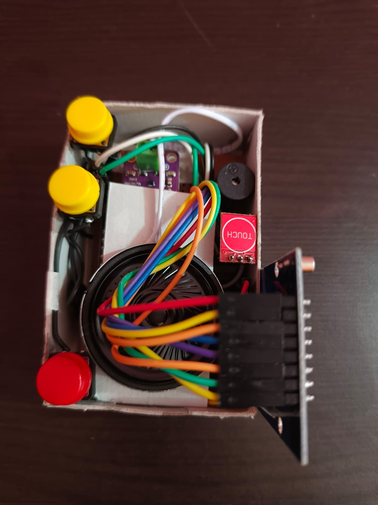
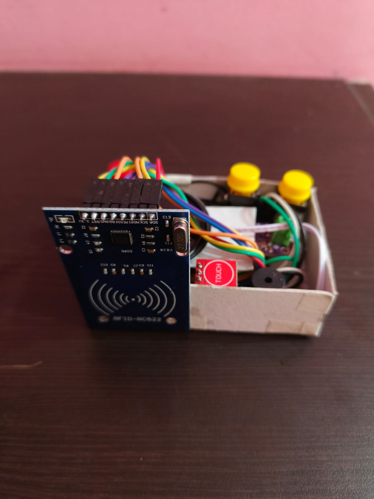

# Universal Health ID (UHID) System

A web-based healthcare information management prototype developed as a Database Management System (DBMS) mini-project. The system integrates a Flask backend, MySQL database, web-based user interfaces, and ESP32-based RFID authentication to demonstrate centralized patient information management.

## Overview

Healthcare information is often distributed across hospitals, diagnostic laboratories, and clinics. Retrieving previous reports, prescriptions, and other medical documents can be challenging when records are maintained separately.

The Universal Health ID (UHID) System aims to organize patient information under a unique health identifier. It provides separate interfaces for patients and healthcare professionals, database-backed record management, access request handling, and hardware-assisted authentication.

This project demonstrates the integration of relational database design, web application development, authentication, and embedded systems.

> **Project status:** Academic prototype. The system uses sample information to demonstrate its intended workflows and is not a production-ready healthcare platform.

## Key Features

### Patient Management
- Patient profiles associated with unique health identifiers (UHIDs).
- Patient dashboard and UHID card interface.
- Sections for medical records, health history, consultations, prescriptions, and notifications.
- Profile and access-history interfaces.

### Healthcare Professional Management
- Separate doctor registration and workspace interfaces.
- Doctor profiles with specialization and hospital associations.
- Patient search and access request workflow.
- Access request status management.

### Database Management
- Relational database implemented using MySQL.
- Primary keys, foreign keys, unique constraints, and referential integrity.
- Centralized management of user, patient, doctor, and hospital information.
- Medical record metadata and document path management.
- Access logging for auditing relevant system activities.

### Hardware-Based Authentication
- ESP32 microcontroller integration.
- MFRC522 RFID card reader.
- PIN entry using push buttons.
- Capacitive touch sensor for initiating the authentication workflow.
- Audio prompts and buzzer feedback.
- Communication between the ESP32 hardware and Flask backend.

## Technology Stack

| Component | Technology |
|---|---|
| Frontend | HTML, CSS, JavaScript |
| Backend | Python, Flask |
| Database | MySQL |
| Database Hosting | Aiven Cloud |
| Authentication | JWT, Werkzeug password hashing |
| Authorization | Role-Based Access Control (RBAC) |
| Embedded Platform | ESP32 |
| RFID Module | MFRC522 |
| Audio Hardware | MAX98357 I2S amplifier |
| Version Control | Git, GitHub |

## System Architecture

The system follows a three-layer architecture.

1. **Client Layer:** Web browsers provide the patient and healthcare professional interfaces. The ESP32 hardware module provides RFID-based authentication.
2. **Backend Layer:** A Python Flask application handles authentication, application routes, authorization checks, and database operations.
3. **Database Layer:** MySQL stores user profiles, patient information, doctor details, hospital information, medical records, access requests, and access logs.

### Authentication Workflow

1. The user activates the hardware using the touch sensor.
2. The ESP32 provides an audio prompt.
3. The RFID reader reads the card UID.
4. The user enters a PIN using the push buttons.
5. The ESP32 communicates with the Flask backend.
6. The backend verifies the authentication request using the database and configured validation logic.
7. The system returns the authentication result and records the relevant access event.
8. The authorized user can proceed to the appropriate interface.

The exact validation steps depend on the configured backend and firmware implementation.

## Database Schema

The system contains seven principal tables.

| Table | Description |
|---|---|
| `users` | User accounts, credentials, and roles |
| `hospitals` | Hospital details |
| `patients` | Patient profiles and UHIDs |
| `doctors` | Doctor profiles and hospital associations |
| `medical_records` | Patient medical record metadata |
| `access_logs` | System access and audit events |
| `access_requests` | Doctor requests for patient information |

The database schema is initialized through the Python script `_init_db.py`, which executes MySQL table-creation statements using the configured database connection.

## Hardware Requirements

| Component | Purpose |
|---|---|
| ESP32 | Controls peripherals and communicates with the backend |
| MFRC522 | Reads RFID card identifiers |
| Capacitive touch sensor | Initiates the authentication workflow |
| Push buttons | Accept PIN input |
| MAX98357 I2S amplifier | Provides audio prompts |
| Buzzer | Provides authentication feedback |

Refer to the hardware wiring documentation and firmware configuration for the exact GPIO assignments and connection details.

## Security Considerations

- Passwords should be stored as secure hashes rather than plain text.
- Database operations should use parameterized queries.
- Protected endpoints should enforce authentication and role-based authorization.
- Database credentials and cryptographic secrets must not be committed to the repository.
- Communications carrying authentication data should use HTTPS where supported.
- RFID UIDs alone are not strong proof of identity; additional safeguards are necessary for real-world deployment.
- Medical information should only be accessible to appropriately authorized users.

This prototype is intended for educational demonstration and should undergo security, privacy, and reliability testing before any real patient information is used.

## 📸 Project Gallery

### Hardware Implementation

The hardware component integrates the ESP32 with RFID-based authentication and supporting input and audio modules.

| Hardware Setup 1 | Hardware Setup 2 |
|---|---|
|  |  |

### Web Application

The web application provides the interface for accessing the Universal Health ID (UHID) system and managing patient-related information.

| Web Interface 1 | Web Interface 2 | Web Interface 3 |
|---|---|---|
|  |  |  |

## Limitations

- The project is a prototype and is not certified for clinical use.
- Sample data may be used to demonstrate the interfaces.
- Actual medical record availability depends on the records entered into the system.
- Integration with external hospitals, laboratories, insurance providers, and pharmacy systems is not implied.
- AI-based diagnostic support and wearable-device integration are proposed future enhancements, not assumed current features.

## Future Enhancements

- Integration with standardized digital health record systems.
- Stronger patient identity verification and consent management.
- Improved audit trails and access revocation.
- Secure integration with wearable health devices.
- Automated organization of insurance documentation.
- AI-assisted analysis tools designed to support, not replace, qualified healthcare professionals.

## Disclaimer

This project is developed for academic and educational purposes. It is not an official government-issued health identity service and should not be used as a substitute for a certified healthcare information system.
